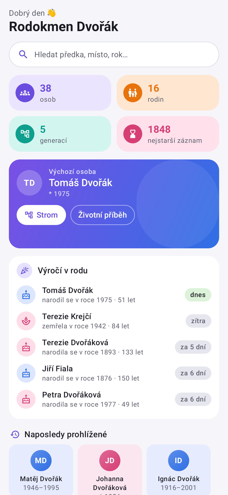
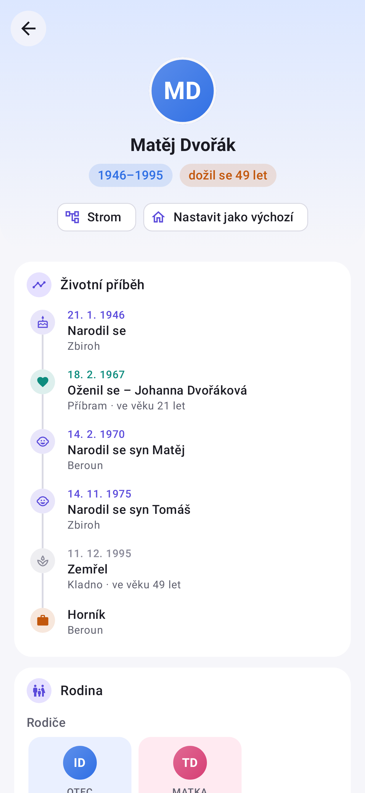
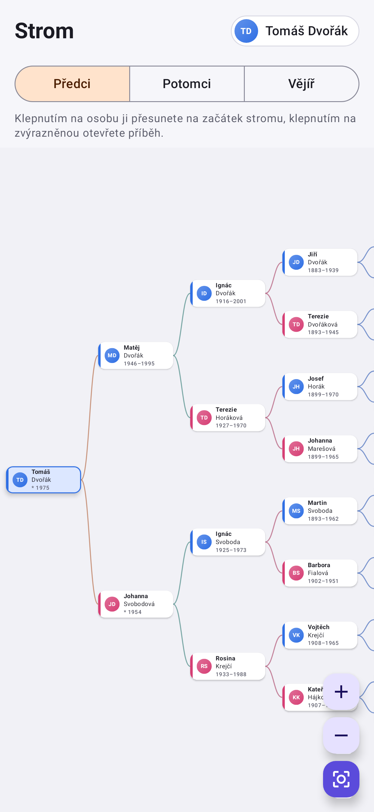
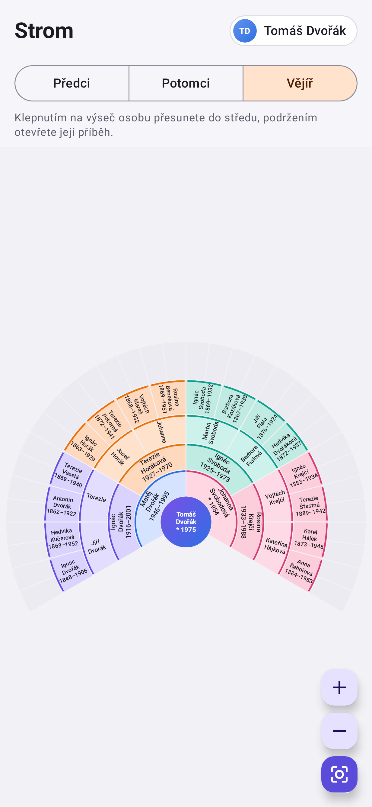

# Moje kořeny

Genealogická aplikace pro Android napojená na rodinný web. Funguje i offline,
umí GEDCOM a (později) fotografie u osob a úpravy synchronizované s webem.

Návrh a plán: [docs/NAVRH.md](docs/NAVRH.md)

## Stav – fáze 0

- `gedcom/` – knihovna v čistém Kotlinu: čtení a zápis GEDCOM 5.5.1 i 7.0,
  kódování UTF-8 / UTF-16 / ANSEL / windows-1250, CONC/CONT, česká i GEDCOM data
  („9. 5. 1849“, „asi 1849“, `BET 1850 AND 1855`), zachování neznámých značek
  jiných programů. Testy: `./gradlew :gedcom:test`.
- `app/` – Android aplikace (Jetpack Compose): import `.ged`, seznam osob
  s hledáním bez diakritiky, detail osoby s událostmi, rodinou, poznámkami
  a prameny, export do GEDCOM 5.5.1 / 7.0. Rodokmen zůstává v telefonu
  i po restartu.

## Verze 0.3 – barevný vzhled a vějířový graf

Moderní barevný vzhled, kompaktnější obrazovky, nová ikona. Strom ve třech
pohledech: předci, potomci a vějířový graf (5 generací); přiblížení prsty
nebo tlačítky +/−, strom už nepřekrývá ovládací prvky.

| Domů | Detail | Strom | Vějíř |
|---|---|---|---|
|  |  |  |  |

Snímky jsou ze smyšleného rodokmenu. Vytvoří se bez emulátoru:
`./gradlew :app:testDebugUnitTest` → `app/build/snimky/`.

## Stažení APK

Každé odeslání na GitHub sestaví APK v **Actions → Sestavení → Artifacts
(`moje-koreny-apk`)**. Po označení verze (`git tag v0.1.0 && git push --tags`)
se APK přiloží k vydání v **Releases**.

Instalace: stáhnout `moje-koreny-<číslo>.apk` do telefonu, otevřít a povolit
instalaci z tohoto zdroje.

## Vývoj

Potřeba: JDK 17+, Android SDK (platforma 36).

```sh
./gradlew :gedcom:test          # testy knihovny GEDCOM
./gradlew :app:assembleDebug    # app/build/outputs/apk/debug/app-debug.apk
```
